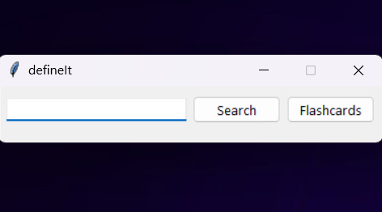
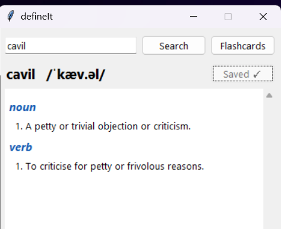
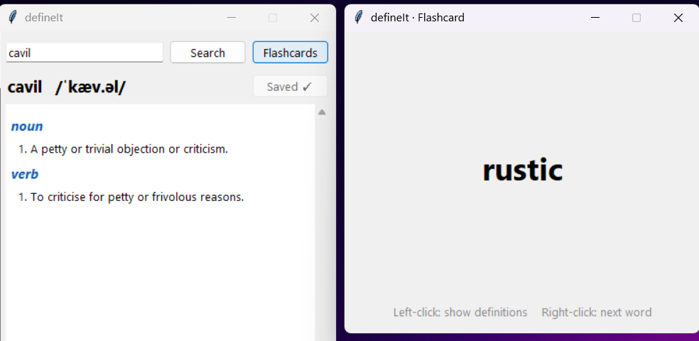
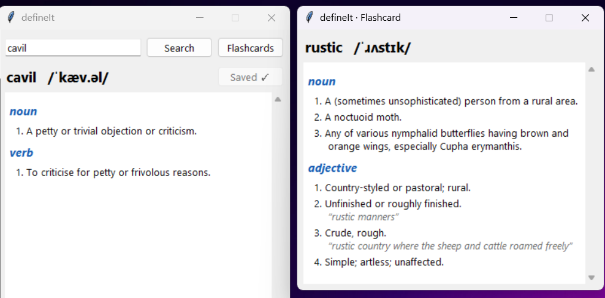

# defineIt

**defineIt** is a lightweight desktop dictionary application built with Python and Tkinter. It allows users to look up English words using [DictionaryAPI](https://dictionaryapi.dev/), save words locally, and revise their vocabulary using random flashcards.

## Features

- **Word Lookup:** Search for English words and retrieve their definitions from DictionaryAPI.
- **Multiple Definitions:** Display all available meanings, grouped by part of speech, along with examples, synonyms, and antonyms.
- **Save Words:** Save dictionary entries locally in JSON Lines (`.jsonl`) format.
- **Flashcards:** Display randomly selected saved words and reveal their definitions.
- **Compact Interface:** Keep the main window small when idle and expand it when displaying definitions.

## Requirements

- Python 3.8 or later
- Internet connection for dictionary lookups
- `requests` library

## Installation and Setup

1. Clone the repository:

   ```bash
   git clone <repository-url>
   ```

2. Navigate to the project directory:

   ```bash
   cd defineIt
   ```

3. Install the required dependencies:

   ```bash
   pip install -r requirements.txt
   ```

4. Run the application:

   ```bash
   python main.py
   ```

## Usage

### Dictionary Lookup

1. Enter an English word in the search field.
2. Click **Search** or press `Enter`.
3. The application retrieves and displays the available definitions, organized by part of speech.
4. Click **Save Word** to add the entry to your local vocabulary collection.

### Flashcards

1. Click **Flashcards** to open the flashcard window.
2. A randomly selected word from your saved vocabulary will appear.
3. **Left-click** to reveal its definitions.
4. **Right-click** to retrieve another random word.

## Screenshots

### 1. Application Entrypoint


### 2. Search Output


### 3. Flashcard — Word


### 4. Flashcard — Definitions


## Local Data Storage

The application maintains two local files:

- **saved_words.jsonl:** Stores saved dictionary entries as individual JSON objects, one per line. This format supports efficient appending and random-access retrieval.
- **config.json:** Stores application configuration, including the last position of the main window.

## API

Dictionary data is provided by [Free Dictionary API](https://dictionaryapi.dev/).

## License

This project is open-source and available for personal and educational use.